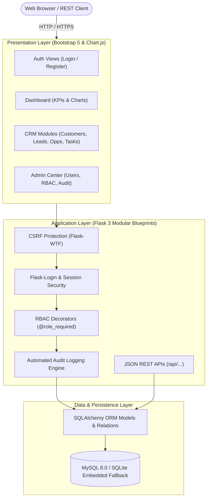
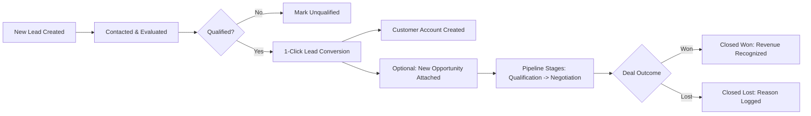

# AcxiomCRM – System Flow Architecture & End-to-End Testing Guide

This document provides a comprehensive overview of the **AcxiomCRM** application architecture, entity lifecycle flows, role-based permissions, and a step-by-step verification guide.

---

## 1. System Architecture & Component Flow



---

## 2. Core Business Process Flows

### 2.1 Lead-to-Revenue Conversion Flow
The primary sales funnel connects leads to closed revenue through structured milestones:



### 2.2 Role-Based Access Control (RBAC) Matrix

| Feature / Resource | Sales Executive | Manager | Admin |
|---|:---:|:---:|:---:|
| **Dashboard KPIs & Charts** | Assigned data | Team / All data | All data |
| **Customer CRUD** | Assigned records | All records | Full access |
| **Lead Management** | Assigned records | All records | Full access |
| **Lead Conversion** | ✅ (Assigned) | ✅ | ✅ |
| **Opportunity & Pipeline** | Assigned records | All records | Full access |
| **Follow-ups & Activities** | Assigned records | All records | Full access |
| **User Administration** | ❌ Forbidden (403) | ❌ Forbidden (403) | ✅ Full access |
| **System Audit Logs** | ❌ Forbidden (403) | ❌ Forbidden (403) | ✅ Full access |

---

## 3. Seed Accounts for Testing

The database comes pre-seeded with three tiers of user accounts:

| User Role | Email | Password | Primary Purpose |
|---|---|---|---|
| **Administrator** | `admin@acxiomcrm.com` | `Admin@123` | Full access, user admin, audit logs, configuration |
| **Sales Manager** | `sarah.manager@acxiomcrm.com` | `Manager@123` | Pipeline reviews, cross-team supervision |
| **Sales Executive** | `alex.sales@acxiomcrm.com` | `Sales@123` | Individual pipeline, task tracking, customer interactions |

---

## 4. Step-by-Step Functional Testing Guide

Ensure the server is running on `http://127.0.0.1:5050`.

### Test Case 1: Authentication & Session Security
1. Navigate to **`http://127.0.0.1:5050/login`**.
2. Attempt login with an invalid password (e.g., `wrongpass`).
   - **Expected**: Alert displays `"Invalid email or password."`.
3. Log in with `admin@acxiomcrm.com` / `Admin@123`.
   - **Expected**: Redirected to `/dashboard` with a welcome indicator in the top navbar.
4. Click on the profile dropdown in the top right corner and select **Logout**.
   - **Expected**: Redirected to `/login` with an informational notice `"You have been logged out."`.

### Test Case 2: Dashboard KPIs & Interactive Visualizations
1. Log in as `admin@acxiomcrm.com`.
2. Inspect the 6 KPI cards across the top:
   - **Total Customers**: Shows current customer count.
   - **Total Leads**: Shows un-converted + converted leads.
   - **Open Opps**: Quantifies active pipeline stages.
   - **Won / Lost Opps**: Historical wins and losses.
   - **Pipeline Value**: Real-time aggregated monetary sum.
3. Review the **Sales Pipeline** bar chart and **Opportunity Status** doughnut chart powered by Chart.js.
4. Check the **Upcoming Follow-ups** widget:
   - Items with a due date in the past display an **Overdue** badge.

### Test Case 3: Customer Management & Cascade Protection
1. In the sidebar, click **Customers** (`/customers/`).
2. Click **Add Customer** (`/customers/create`):
   - Enter `Name`: `"Tesla Energy"`, `Company`: `"Tesla"`, `Industry`: `"Technology"`.
   - Click **Save Customer**.
   - **Expected**: Customer detail page displays newly persisted information.
3. Attempt to delete a customer with related opportunities:
   - Go to **Acme Cloud Solutions** detail page (`/customers/1`).
   - Click **Delete**.
   - **Expected**: Blocked with an alert: `"Cannot delete... has related opportunities"`.

### Test Case 4: Lead Lifecycle & 1-Click Conversion Engine
1. Click **Leads** in the sidebar (`/leads/`).
2. Locate a qualified lead or create a new one:
   - Click **Add Lead**.
   - Enter `Name`: `"Bruce Wayne"`, `Company`: `"Wayne Enterprises"`, `Status`: `"Qualified"`, `Rating`: `"Hot"`.
   - Save the record.
3. In the lead detail page, click the green **Convert** button (`/leads/<id>/convert`):
   - Check the box: `"Also Create an Opportunity"`.
   - Opportunity Name: `"Wayne Global Security Contract"`, Amount: `250000`, Stage: `"Proposal"`.
   - Submit **Convert Lead**.
   - **Expected**:
     - A new Customer `"Bruce Wayne"` is created.
     - A new Opportunity `"Wayne Global Security Contract"` is linked.
     - The lead status is updated to `Converted`, and the conversion timestamp is recorded.

### Test Case 5: Opportunity Pipeline & Kanban Board
1. Click **Opportunities** in the sidebar (`/opportunities/`).
2. Click **Pipeline View** in the top header (`/opportunities/pipeline`).
   - **Expected**: Kanban board columns display stages: *Qualification, Needs Analysis, Proposal, Negotiation, Closed Won, Closed Lost*.
   - Each column displays the count of deals and their total values.
   - Summary statistics at the top show weighted forecast vs. total pipeline value.

### Test Case 6: Follow-up Scheduling & Overdue Detection
1. Click **Follow-ups** (`/followups/`).
2. Click **Schedule Follow-up**:
   - Subject: `"Product Architecture Sync"`.
   - Due Date: Set to yesterday's date.
   - Link to Customer `"Tesla Energy"`.
   - Click **Save**.
   - **Expected**: The record shows in the table flagged with a red **Overdue** badge.
3. Click the checkmark button (Complete) on any pending follow-up.
   - **Expected**: Status transitions to `Completed`.

### Test Case 7: RBAC Access Control & User Administration
1. Log in as **Sales Executive** (`alex.sales@acxiomcrm.com` / `Sales@123`).
2. In the browser URL bar, attempt to access `/users/` or `/audit/`.
   - **Expected**: HTTP 403 Forbidden error page rendered.
3. Log out and log back in as **Admin** (`admin@acxiomcrm.com`).
4. Access **Users** (`/users/`):
   - Click **Add User**, create a new sales team member, and verify role assignment.
   - Test the Deactivate action on any user (except yourself).

### Test Case 8: Security Audit Trail
1. As **Admin**, click **Audit Log** (`/audit/`).
2. **Expected**: Chronological timeline of events displaying:
   - `Timestamp`
   - `User` (or System)
   - `Action` (`Login`, `Create`, `Update`, `Delete`)
   - `Entity` (`Customer`, `Lead`, `Opportunity`, etc.)
   - `Client IP Address`
3. Use the filter bar to filter by Action: `Create` or Entity: `Lead` to verify search filtering.

---

## 5. Automated Testing Suite

AcxiomCRM includes an automated `unittest` test suite in `tests.py` using in-memory databases with isolated transactions.

### Running the Test Suite:
```powershell
cd C:\Users\kotte\.gemini\antigravity\scratch\AcxiomCRM
python tests.py
```

### Coverage Scope:
- `test_seed_and_admin_user`: Verifies default roles, permissions, and admin account integrity.
- `test_login_logout`: Asserts authenticated session flow and CSRF handling.
- `test_customer_crud`: Tests Create, Read, Update, Delete with cascade handling.
- `test_lead_conversion`: Asserts atomic lead-to-customer conversion and opportunity generation.
- `test_opportunity_pipeline_and_kpis`: Validates weighted calculations and pipeline stages.
- `test_api_endpoints`: Verifies JSON REST payloads for Customers and Opportunities.
- `test_audit_log`: Verifies automatic CRUD audit event recording.

---

## 6. REST API Testing (cURL / PowerShell)

### Authenticated Customer Retrieval:
```powershell
# In PowerShell:
$session = New-Object Microsoft.PowerShell.Commands.WebRequestSession
Invoke-RestMethod -Uri "http://127.0.0.1:5050/login" -Method Post -Body @{ email="admin@acxiomcrm.com"; password="Admin@123" } -WebSession $session
$customers = Invoke-RestMethod -Uri "http://127.0.0.1:5050/customers/api/customers" -Method Get -WebSession $session
$customers | ConvertTo-Json -Depth 3
```

### Dashboard Statistics Endpoint:
```powershell
$stats = Invoke-RestMethod -Uri "http://127.0.0.1:5050/api/dashboard/stats" -Method Get -WebSession $session
$stats | ConvertTo-Json
```
